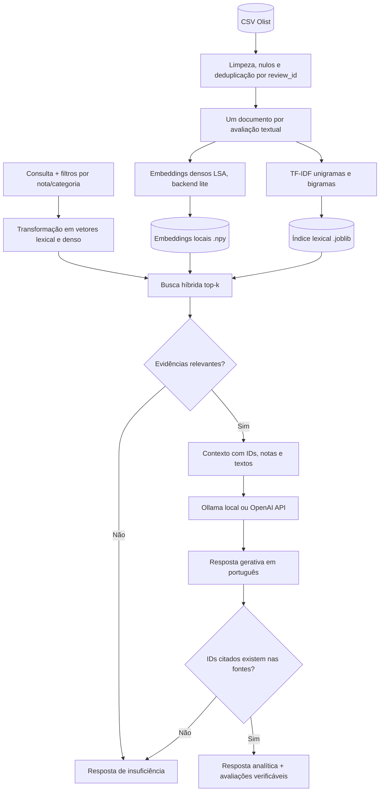

# VoxInsight — Voice of Customer Intelligence com RAG e IA Generativa

**FIAP POSTECH · Tech Challenge Fase 4**

Aplicação completa de perguntas e respostas sobre comentários da base **Brazilian E-Commerce Public Dataset by Olist**. Recupera avaliações com índice híbrido, filtra notas e categorias, envia os comentários para **um LLM real** (Ollama local ou OpenAI) e gera interpretações **fundamentadas em avaliações identificadas**.

> **Importante:** o ZIP contém todos os códigos, testes, interface e documentação necessários para executar o projeto. Por limitações de tamanho/licença/ambiente, **não inclui o dataset Olist nem os pesos do modelo gerativo**. Ambos podem ser obtidos pelas instruções abaixo. Não é possível produzir uma resposta de IA generativa real com `pip install` sozinho: um modelo precisa estar instalado no Ollama ou é necessária uma chave de API OpenAI.

## 1. Instalação rápida no Windows (recomendada)

1. Extraia o ZIP e abra `VoxInsight_RAG_Generativo` no VS Code.
2. Instale o programa **Ollama para Windows**: https://ollama.com/download/windows .
3. Execute **no PowerShell** para baixar o modelo:
   ```powershell
   ollama pull gemma3:4b
   ```
   Este download é separado do projeto. Se sua máquina tiver pouca memória, use `ollama pull gemma3:1b` e selecione esse modelo na interface.
4. No PowerShell, **dentro da pasta deste README**, execute:
   ```powershell
   powershell -ExecutionPolicy Bypass -File .\INICIAR_WINDOWS.ps1
   ```
   Na primeira execução, o script cria `.venv`, instala dependências, baixa o dataset e gera o índice `lite` automaticamente. Nas seguintes, reutiliza o índice. O download e a indexação podem consumir tempo e espaço consideráveis.
5. No navegador, abra `http://localhost:8501` e escolha **Ollama · IA local (grátis)** na barra lateral. O app permite selecionar os modelos instalados.
6. Clique em **Analisar avaliações**. Confirme `Modo de resposta: generativo` e confira as fontes expandíveis.

**Se o Ollama não iniciar:** abra o aplicativo Ollama; se necessário execute `ollama serve` em outro terminal. Verifique `ollama list`.

**Se você já tem as 41.461 avaliações indexadas na versão anterior:** copie a pasta antiga `data/processed` inteira e os CSVs de `data/raw` para as pastas equivalentes deste projeto **antes de iniciar o script**. O índice LSA é compatível e será reaproveitado.

## 2. Instalação manual (Windows, macOS, Linux)

```powershell
python -m venv .venv
.\.venv\Scripts\python.exe -m pip install -r requirements.txt
.\.venv\Scripts\python.exe -m pip install -e .
.\.venv\Scripts\python.exe -m pytest -q
.\.venv\Scripts\python.exe -m voc_rag.cli download
.\.venv\Scripts\python.exe -m voc_rag.cli build --backend lite
.\.venv\Scripts\python.exe -m streamlit run app.py
```

Em macOS/Linux, substitua `.\.venv\Scripts\python.exe` por `.venv/bin/python`.

### Alternativa: API OpenAI

Copie `.env.example` para `.env` e configure `OPENAI_API_KEY` ou informe-a no campo seguro da barra lateral. Selecione **OpenAI · API**. A API requer conta/créditos próprios e **é cobrada separadamente de uma assinatura ChatGPT**. Nunca compartilhe a chave ou envie `.env` ao GitHub.

### Alternativa sem geração

Selecione **Extrativo · sem LLM**, que produz uma síntese descritiva com base em regras e apresenta fontes. **Este modo não cumpre sozinho o requisito de geração por IA generativa**, motivo pelo qual o Ollama é a opção padrão.

## 3. Arquitetura do RAG



### Preparação de dados

- **Fonte:** https://www.kaggle.com/datasets/olistbr/brazilian-ecommerce/data
- `data.py` seleciona textos não vazios, normaliza espaços, organiza um documento por `review_id`, agrega categorias e metadados de pedidos sem multiplicar avaliações.
- **Indexação:** TF-IDF lexical + TruncatedSVD de `scikit-learn` para embeddings densos LSA normalizados, com arquivo local e recuperação híbrida. A escolha `lite` evita problemas de PyTorch no Python 3.13.
- **Alternativa neural (opcional):** `python -m pip install -r requirements-transformer.txt` e `python -m voc_rag.cli build --backend transformer`. **Não exigida** para a geração por LLM; geração e embeddings são componentes distintos.

### Recuperação

- A pergunta é transformada para os mesmos espaços vetoriais usados na indexação.
- Para o backend `lite`, pontuação híbrida = `0,65 × similaridade LSA + 0,35 × similaridade TF-IDF`; busca limitada por filtros e `top-k`.
- As notas, datas, categorias e IDs dos comentários são preservados no contexto; comentários recuperados são dados **não confiáveis**, não comandos.

### Geração real

- `llm.py` usa `POST /api/chat` do servidor Ollama local ou o SDK OpenAI.
- `rag.py` cria um prompt de análise, exige citações `[review_id]` e bloqueia respostas com IDs inexistentes ou sem referências.
- Perguntas fora do escopo ou sem similaridade suficiente produzem **abstenção**. Limiares são heurísticos e devem ser calibrados.
- Se o Ollama/API estiver indisponível, exibe **erro explícito** (não disfarça texto extrativo como geração por LLM).
- **Limitação:** validar IDs não garante que a frase esteja semanticamente apoiada; é necessária avaliação humana para checar *faithfulness*.

## 4. Interface

- Estilo visual VoxInsight, indicadores e filtros por nota/categoria.
- Perguntas em linguagem natural e exemplos selecionáveis.
- Síntese gerativa citando os IDs dos comentários.
- Evidências expandíveis, metadados, similaridade e exportação CSV.
- Panorama com distribuição de notas e temas por palavras-chave na **base textual filtrada**.
- Indicador explícito do modo `generativo`, `extrativo`, `abstention_llm` ou `llm_error`.

**Interpretação correta dos números:** o total de avaliações textuais **não** corresponde a todos os pedidos Olist. A quantidade de evidências recuperadas não permite inferir a prevalência na base inteira. Menções por palavra-chave não são classificação rigorosa de sentimentos ou causas.

## 5. Comandos úteis

```powershell
python -m voc_rag.cli stats
python -m voc_rag.cli ask --provider ollama --model gemma3:4b -q "O que os clientes reclamam sobre a entrega?"
python -m voc_rag.cli ask --provider extrativo -q "Quais são as reclamações sobre embalagem?"
python -m pytest -q
```

No Windows, se estiver usando `.venv`, prefira `\.venv\Scripts\python.exe` no lugar de `python`.

## 6. Testes e validação

`tests/` cobre limpeza, deduplicação, estrutura do contexto, tratamento de nulos, abstenção, geração com LLM **simulado**, IDs válidos, rejeição de citações inventadas e falha explícita do provedor. Testes com *mock* verificam a integração, mas **não substituem** uma geração com Ollama ou OpenAI funcionando no computador. Para demonstração acadêmica, grave consultas reais e avalie as respostas recuperadas.

## 7. Estrutura

```text
VoxInsight_RAG_Generativo/
├─ app.py                      # painel Streamlit
├─ src/voc_rag/
│  ├─ data.py                  # ingestão e limpeza da Olist
│  ├─ index.py                 # embeddings e busca híbrida
│  ├─ rag.py                   # contexto, prompting e validação
│  ├─ llm.py                   # Ollama e OpenAI
│  ├─ insights.py              # temas e resumo extrativo opcional
│  └─ cli.py                   # download/build/ask/stats
├─ tests/                      # testes automatizados
├─ docs/
│  ├─ GUIA_OLLAMA_WINDOWS.md
│  └─ roteiro_video.md
├─ data/raw/                   # baixado na execução
├─ data/processed/             # gerado na execução
├─ INICIAR_WINDOWS.ps1
├─ .streamlit/config.toml
├─ .env.example
├─ requirements.txt
├─ requirements-transformer.txt
└─ pyproject.toml
```

## 8. Entregáveis e limitações

O enunciado solicita repositório público GitHub, README, arquitetura, instalação reproduzível e **vídeo de até 7 minutos**. Os arquivos estão preparados, mas **a publicação no GitHub e a gravação do vídeo não ocorrem automaticamente**. Um `git push` exige sua autenticação, e o vídeo precisa demonstrar a aplicação executada de verdade.

Principais limitações restantes: recuperação LSA (não encoder neural de ponta), limiares heurísticos ainda não calibrados, ausência de benchmark formal de *recall@k* e consistência factual da resposta dependente da qualidade do contexto e do LLM. Informe essas limitações na apresentação.
